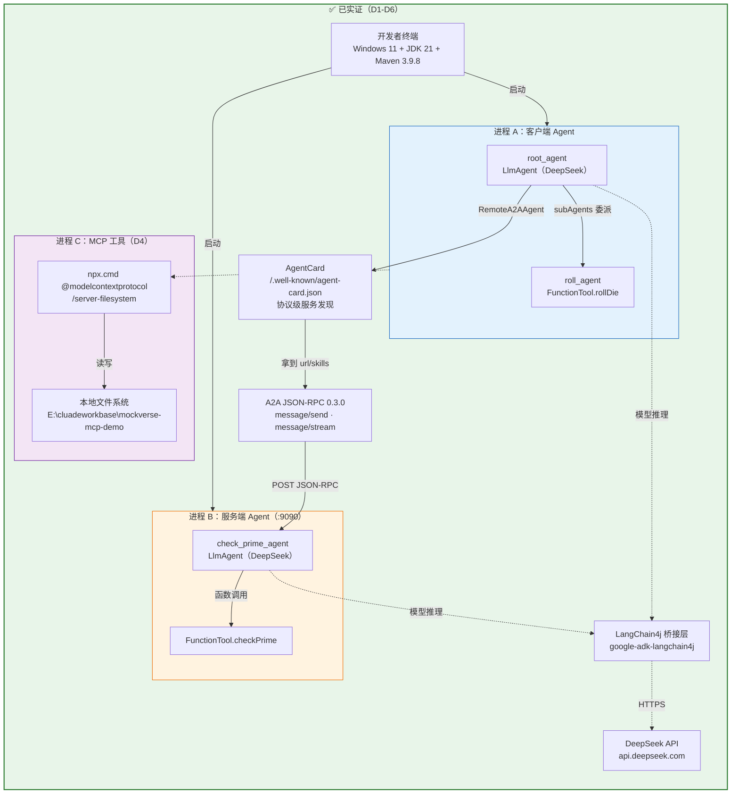
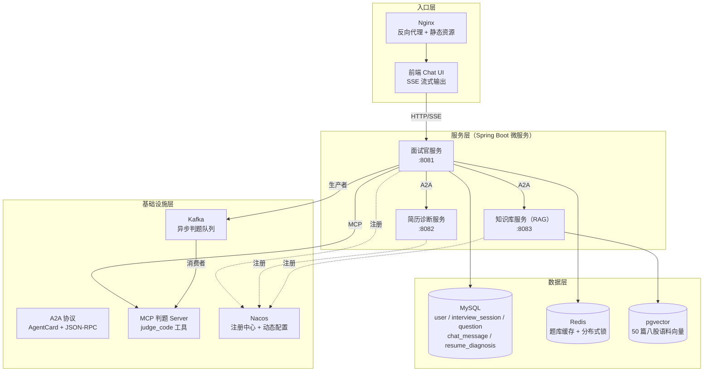
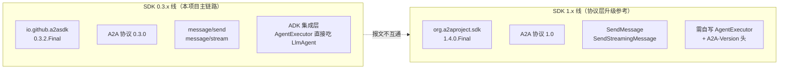

# MockVerse 架构图

> D7 产出。**原则：实线 = 已实证跑通，虚线 = 计划中未实证。** 这张图只画"我能当场演示"的东西。
> 更新纪律：每完成一个里程碑，把对应虚线改实线；任何一条实线都有 `docs/journal/` 里的运行日志可查。

---

## 一、当前实证架构（D6 结束时的真实状态）



**这张图能当场演示的三件事：**

1. **跨进程 Agent 协作**：客户端掷骰 → 把结果交给 9090 端口的独立进程判断素数（D5）
2. **协议级服务发现**：客户端不配置服务端地址，先拉 AgentCard 再建连（D5）
3. **MCP 工具跨进程调用**：ADK 通过 STDIO 拉起 filesystem server，模型自主编排文件读写（D4）

---

## 二、目标架构（D30 交付态）



> **D18 落地实况**：判题 Server 已实现为**独立第四个进程** `judge-service:8084`
> （MCP Streamable HTTP `/mcp`），而不是嵌在面试官服务里——这样它能被任何 MCP 客户端复用，
> 面试官只需知道一个 URL。上图的端口分配是 D30 目标态，实际拆分时 knowledge=8082、
> resume=8083（与图中相反），以 STATUS 第六节的"四服务现状"表为准。

---

## 三、A2A SDK 的版本线（D6 实证 + D7 复查修正）



**关键修正（D7）**：这不是"两套实现"，而是**同一个官方 SDK 的两条大版本线**。
`google-adk-a2a` 的 pom 直接依赖 `io.github.a2asdk:a2a-java-sdk-*:0.3.2.Final`，ADK 只是在其上做集成层（Event↔Part 转换、AgentExecutor、RemoteA2AAgent）。

**为什么主链路选 0.3.x 线**：Agent 编排在 ADK 里，A2A 化只需一个 `@Produces` Bean；版本跟随框架，避免自己做 0.3 ↔ 1.0 的报文转换。
**1.x 线的价值**：第三周做"纯工具型 A2A 服务"（不带 Agent 框架）时的候选，其 extras 里的 Kafka 复制队列 / JPA 任务存储 / OTel 是架构参考。

> ⚠️ **D7 复查的重要发现**：`a2a/README.md` 宣称的 `a2a/webservice`（Spring Boot 传输模块）**在 1.13.0 里不存在**。
> 第三周的 A2A-over-Spring-Boot 绑定必须**自己写**，不能指望官方模块。详见 `docs/a2a-comparison-d6.md` 第四节。

---

## 四、架构演进路线

| 阶段 | 架构形态 | 状态 |
|---|---|---|
| D1-D6 | 单进程 Agent + 跨进程 A2A 示例 + MCP 工具 | ✅ 已实证 |
| D8-D14 | 单体 v1：一个 Spring Boot 服务装三个 Agent + MySQL | ✅ 已实证（D21 退役，基线 tag `v0.1-monolith`） |
| D15-D21 | 微服务化：三服务 A2A 互联 + MCP 判题 + Kafka 异步 | ✅ 已实证（D15-D21） |
| D22-D26 | 工程化：**Redis（D23 ✅）** + **Nacos（D23 ✅）** + Compose（D24） + 前端（D25） | 🟡 进行中 |
| D27-D30 | 收尾：简历 + 已知局限清单（**演示视频按用户决定移除，见 charter 第四节**） | ⏳ |

> **D9 已落地的单体内部结构**（面试可讲的"从示例到工程"的跨越）：
>
> ```
> InterviewController (HTTP)
>   └─ InterviewService（会话/轮次/落库的事务边界）
>        └─ AgentRuntime（Runner + InMemorySessionService，管理 ADK 生命周期）
>             └─ LlmAgent（instruction 由 InterviewerPrompts 版本化）
>                  ├─ model: DeepSeek（经 google-adk-langchain4j 适配）
>                  └─ tool: pick_question → QuestionTools → QuestionMapper → MySQL
> ```
>
> 关键点：**Agent 不是被"调用一次"，而是被"装配成 Bean"**；工具是 Spring Bean，所以能拿 Mapper；会话状态在 Runtime 里，业务状态在 `chat_message` 里，两者职责分开。
>
> **D23 已落地的支撑层**（四个服务共用，都是"加速器/发现手段"而非依赖）：
>
> ```
> interview-service
>   ├─ QuestionCache ──┐
>   ├─ SessionLock   ──┼─→ RedisGateway（失败冷却 30s）──→ Redis 6379
>   └─ SseRateLimiter─┘        失败时：缓存回源 / 锁降级 / 限流放行
>
> 四个服务
>   ├─ NacosRegistrar      → ApplicationReadyEvent 后注册（ephemeral + 自动心跳）
>   └─ NacosConfigRefresher（仅 interview）→ 监听 interview-service.yaml，
>                                            max-rounds 改完对新会话即时生效
> ```
>
> 关键点：**Redis 挂了面试照常能答**（缓存回源 MySQL、锁降级为无锁、限流放行），
> health 里 `cache` 单独报但 `status` 不降级——加速器故障不该让编排器重启一个没坏的服务。
> Nacos 注册失败同样只 WARN：注册中心是发现手段，不是服务本体。

> **D10 已落地的 RAG 链路**（与面试链路并列，互不依赖）：
>
> ```
> KnowledgeController (HTTP)
>   └─ KnowledgeService（幂等入库 / 检索入口）
>        ├─ KnowledgeLoader   → classpath:knowledge/*.md，按 `## ` 切 50 块
>        ├─ PgVectorStore     → 自持 Hikari 池 → pgvector（vector(512), HNSW, 余弦）
>        │    └─ EmbeddingModel → 本地 ONNX bge-small-zh-v1.5（不联网、无 API Key）
>        └─ RagAnswerService  → 检索结果拼上下文 → DeepSeek(0.2) → 带 [编号] 引用的回答
> ```
>
> 两个数据源刻意不共享：MySQL 走 Spring 自动配置的 DataSource（MyBatis-Plus 用），pgvector 的连接池是 `PgVectorStore` 的私有资源。原因见 `docs/rag-d10.md` 第三节——**声明第二个 DataSource Bean 会让 Boot 的 MySQL 自动配置整体退避**。
>
> **可用性隔离**：pgvector 连不上时只降级知识库接口（503），面试链路照常。

> **D11 已落地的简历诊断链路**（同样并列，只依赖 MySQL）：
>
> ```
> ResumeController (HTTP)
>   └─ ResumeDiagnosisService
>        ├─ diagnosisChatModel  → DeepSeek(0.3, response_format=json_object)
>        ├─ 三层防线            → 提示词写死 schema / 剥 markdown 代码块 / 语义校验
>        │    └─ 校验失败抛异常，**不落库**（脏数据比没有数据更难处理）
>        ├─ warnIfQuoteNotVerbatim → 验证"逐字摘自原文"的承诺（只告警，不阻断）
>        └─ ResumeDiagnosisMapper → resume_diagnosis（dimensions/issues 存 MySQL JSON 列）
> ```
>
> 与另外两条链路的关键差别：**它的输出要进数据库，所以"格式对不对"从体验问题变成了数据正确性问题**。
> `json_object` 只保证语法合法，字段名拼错、维度少一个、分数给 120 它一样放行——所以语义校验是这条链路的主体，
> 而不是可选项。详见 `docs/journal/D11-2026-11-01.md`。

> **面试用法**：讲这张图时先说"实线部分我都能当场跑给你看"，再说"虚线部分是 30 天计划的剩余部分"。**承认未完成的部分不扣分，把未完成的画成已完成才致命。**
