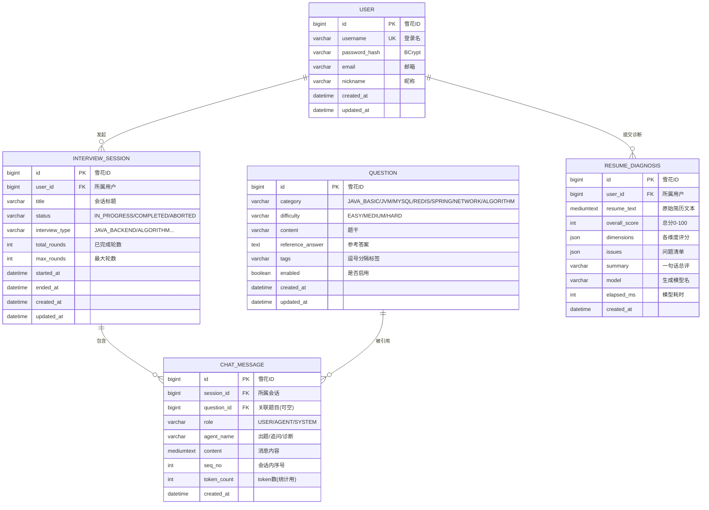

# MockVerse 数据库设计（D7 初稿，D11 增补）

> **五张表**：`user` / `interview_session` / `question` / `chat_message`（D8 落地四表）+ `resume_diagnosis`（D11 新增）。
> 设计目标：支撑"一个用户发起多场模拟面试，每场面试有多轮问答，题目来自题库"这条主链路，
> 以及 D11 起并列的"简历诊断"支线。
> 这份设计同时是**索引优化八股**的素材来源——每个索引都写清"为什么建"。
>
> **D8 落地变更**：会话表由 `session` 改名为 `interview_session`。理由：`session` 虽是 MySQL 非保留字，
> 但作为通用词与 JDBC Session / HTTP Session 撞名，阅读和排错时容易误判；改名成本在 D8 最低。
> `user` 保留原名（业界惯例），仅在 DDL 与 `@TableName` 中加反引号。
>
> **D11 增补**：新增 `resume_diagnosis`。明细（维度评分、问题清单）存 MySQL 8 的 JSON 列，
> 不拆子表——理由见第二节第 5 段的注释，以及第五节的局限说明。

---

## 一、E-R 图



> `RESUME_DIAGNOSIS` 与 `INTERVIEW_SESSION` / `QUESTION` **无关联**：诊断是一次性快照，
> 不挂在某场面试下，也不引用题库。刻意保持独立（D11）。

---

## 二、建表 SQL（MySQL 8.0，InnoDB，utf8mb4）

```sql
-- ============================================================
-- MockVerse 初始化脚本 v0.2（D7 初稿 + D11 增补 resume_diagnosis）
-- 约定：主键用 BIGINT（雪花ID，应用层生成），避免自增在分库时冲突
-- 落地脚本以 mockverse-monolith/src/main/resources/db/schema.sql 为准
-- ============================================================
CREATE DATABASE IF NOT EXISTS mockverse
  DEFAULT CHARACTER SET utf8mb4
  DEFAULT COLLATE utf8mb4_0900_ai_ci;

USE mockverse;

-- ------------------------------------------------------------
-- 1. 用户表
-- ------------------------------------------------------------
CREATE TABLE `user` (
  `id`            BIGINT       NOT NULL COMMENT '主键(雪花ID)',
  `username`      VARCHAR(64)  NOT NULL COMMENT '登录名',
  `password_hash` VARCHAR(100) NOT NULL COMMENT 'BCrypt 哈希,不存明文',
  `email`         VARCHAR(128)          DEFAULT NULL COMMENT '邮箱',
  `nickname`      VARCHAR(64)           DEFAULT NULL COMMENT '昵称',
  `created_at`    DATETIME     NOT NULL DEFAULT CURRENT_TIMESTAMP,
  `updated_at`    DATETIME     NOT NULL DEFAULT CURRENT_TIMESTAMP ON UPDATE CURRENT_TIMESTAMP,
  PRIMARY KEY (`id`),
  UNIQUE KEY `uk_username` (`username`),
  KEY `idx_email` (`email`)
) ENGINE=InnoDB DEFAULT CHARSET=utf8mb4 COMMENT='用户表';

-- ------------------------------------------------------------
-- 2. 面试会话表（D8 由 session 改名，避免与 JDBC/HTTP Session 混淆）
-- ------------------------------------------------------------
CREATE TABLE `interview_session` (
  `id`             BIGINT      NOT NULL COMMENT '主键(雪花ID)',
  `user_id`        BIGINT      NOT NULL COMMENT '所属用户',
  `title`          VARCHAR(128)         DEFAULT NULL COMMENT '会话标题',
  `status`         VARCHAR(20) NOT NULL DEFAULT 'IN_PROGRESS'
                   COMMENT 'IN_PROGRESS/COMPLETED/ABORTED',
  `interview_type` VARCHAR(32) NOT NULL DEFAULT 'JAVA_BACKEND' COMMENT '面试类型',
  `total_rounds`   INT         NOT NULL DEFAULT 0 COMMENT '已完成轮数',
  `max_rounds`     INT         NOT NULL DEFAULT 5 COMMENT '最大轮数(可被 Nacos 动态调整)',
  `started_at`     DATETIME             DEFAULT NULL,
  `ended_at`       DATETIME             DEFAULT NULL,
  `created_at`     DATETIME    NOT NULL DEFAULT CURRENT_TIMESTAMP,
  `updated_at`     DATETIME    NOT NULL DEFAULT CURRENT_TIMESTAMP ON UPDATE CURRENT_TIMESTAMP,
  PRIMARY KEY (`id`),
  KEY `idx_user_created` (`user_id`, `created_at` DESC),
  KEY `idx_status` (`status`)
) ENGINE=InnoDB DEFAULT CHARSET=utf8mb4 COMMENT='面试会话表';

-- ------------------------------------------------------------
-- 3. 题库表
-- ------------------------------------------------------------
CREATE TABLE `question` (
  `id`               BIGINT       NOT NULL COMMENT '主键(雪花ID)',
  `category`         VARCHAR(32)  NOT NULL COMMENT 'JAVA_BASIC/JVM/MYSQL/REDIS/SPRING/NETWORK/ALGORITHM',
  `difficulty`       VARCHAR(16)  NOT NULL DEFAULT 'MEDIUM' COMMENT 'EASY/MEDIUM/HARD',
  `content`          VARCHAR(1000) NOT NULL COMMENT '题干',
  `reference_answer` TEXT                  COMMENT '参考答案',
  `tags`             VARCHAR(255)          DEFAULT NULL COMMENT '逗号分隔标签',
  `enabled`          TINYINT(1)   NOT NULL DEFAULT 1 COMMENT '是否启用',
  `created_at`       DATETIME     NOT NULL DEFAULT CURRENT_TIMESTAMP,
  `updated_at`       DATETIME     NOT NULL DEFAULT CURRENT_TIMESTAMP ON UPDATE CURRENT_TIMESTAMP,
  PRIMARY KEY (`id`),
  KEY `idx_cat_diff_enabled` (`category`, `difficulty`, `enabled`)
) ENGINE=InnoDB DEFAULT CHARSET=utf8mb4 COMMENT='题库表';

-- ------------------------------------------------------------
-- 4. 聊天消息表（最大的表，重点设计）
-- ------------------------------------------------------------
CREATE TABLE `chat_message` (
  `id`          BIGINT      NOT NULL COMMENT '主键(雪花ID)',
  `session_id`  BIGINT      NOT NULL COMMENT '所属会话',
  `question_id` BIGINT               DEFAULT NULL COMMENT '关联题目(追问消息为空)',
  `role`        VARCHAR(16) NOT NULL COMMENT 'USER/AGENT/SYSTEM',
  `agent_name`  VARCHAR(64)          DEFAULT NULL COMMENT '出题/追问/诊断(多 Agent 区分)',
  `content`     MEDIUMTEXT  NOT NULL COMMENT '消息内容',
  `seq_no`      INT         NOT NULL COMMENT '会话内序号,从1递增',
  `token_count` INT         NOT NULL DEFAULT 0 COMMENT 'token 数(统计/成本核算)',
  `created_at`  DATETIME    NOT NULL DEFAULT CURRENT_TIMESTAMP,
  PRIMARY KEY (`id`),
  UNIQUE KEY `uk_session_seq` (`session_id`, `seq_no`),
  KEY `idx_session_created` (`session_id`, `created_at`),
  KEY `idx_question` (`question_id`)
) ENGINE=InnoDB DEFAULT CHARSET=utf8mb4 COMMENT='聊天消息表';

-- ------------------------------------------------------------
-- 5. 简历诊断结果表（D11 新增）
-- ------------------------------------------------------------
CREATE TABLE `resume_diagnosis` (
  `id`            BIGINT       NOT NULL COMMENT '主键(雪花ID)',
  `user_id`       BIGINT       NOT NULL COMMENT '所属用户',
  `resume_text`   MEDIUMTEXT   NOT NULL COMMENT '原始简历文本',
  `overall_score` INT          NOT NULL COMMENT '总分 0-100',
  `dimensions`    JSON         NOT NULL COMMENT '各维度评分 [{name,score,strengths,weaknesses}]',
  `issues`        JSON         NOT NULL COMMENT '问题清单 [{severity,quote,problem,suggestion}]',
  `summary`       VARCHAR(1000)         DEFAULT NULL COMMENT '一句话总评',
  `model`         VARCHAR(64)  NOT NULL COMMENT '生成该结果的模型名(便于换模型后对比)',
  `elapsed_ms`    INT          NOT NULL DEFAULT 0 COMMENT '模型耗时',
  `created_at`    DATETIME     NOT NULL DEFAULT CURRENT_TIMESTAMP,
  PRIMARY KEY (`id`),
  KEY `idx_user_created` (`user_id`, `created_at` DESC),
  KEY `idx_score` (`overall_score`)
) ENGINE=InnoDB DEFAULT CHARSET=utf8mb4 COMMENT='简历诊断结果表';
```

**为什么 `dimensions` / `issues` 用 JSON 列而不是拆子表**：这两类数据只随诊断单**整体读取与展示**，
从不按"某个维度"或"某条问题"单独查询、单独更新。拆表会带来 join 成本与两张子表的维护负担，
换来的只是本项目用不到的行级操作能力。需要按维度统计时，MySQL 8 的 `JSON_EXTRACT` 足够
（如 `SELECT AVG(JSON_EXTRACT(dimensions,'$[0].score')) FROM resume_diagnosis`）。
**代价**：无法给维度名建索引、无法用外键约束 JSON 内部结构——所以结构正确性必须由应用层校验兜底，
这正是 D11 三层防线里"语义校验"存在的原因。

**为什么保留 `resume_text` 原文**：将来换模型（或调提示词）重跑时，要能对**同一份输入**做对比。
不留原文就只能重新找用户要简历，对比也就无从谈起。代价是这张表体积增长快——所以查询必须带上限
（D11 的 `history()` 封顶 50 条）。

---

## 三、索引设计说明（面试重点）

| 索引 | 表 | 为什么建 |
|---|---|---|
| `uk_username` | user | 登录必须唯一；且登录查询走这个唯一索引，天然覆盖 |
| `idx_user_created` | interview_session | 「我的面试历史」按用户查、按时间倒序翻页 → **联合索引避免回表排序**（最左前缀 `user_id` 定位，第二列 `created_at` 直接有序，省掉 filesort） |
| `idx_cat_diff_enabled` | question | 出题时「随机抽一道 MEDIUM 的 MYSQL 题」→ 三列联合，`enabled` 放最后因为区分度最低 |
| `uk_session_seq` | chat_message | ① 保证会话内消息序号唯一，防并发重复插入 ② 查「某会话全部消息按序」直接走索引有序输出 |
| `idx_session_created` | chat_message | 冗余但必要：`seq_no` 可能因重试跳号，按时间排序的兜底路径 |
| `idx_user_created` | resume_diagnosis | 「我的诊断历史」按用户查、按时间倒序 → 与 `interview_session` 同构的联合索引，同样是省掉 filesort |
| `idx_score` | resume_diagnosis | 单列索引，为将来的"分数分布统计"准备。**当前没有任何查询用到它**——属于提前布局，不是已验证的收益 |

**关键取舍：为什么主键用 BIGINT 雪花 ID 而不是自增？**
- 自增 ID 在分库分表时冲突；且会**泄露业务量**（竞品能算出你一天多少单）
- 雪花 ID 趋势递增（时间有序），InnoDB 聚簇索引插入仍是顺序追加，**不会像 UUID 那样随机写导致页分裂**
- 代价：需要处理时钟回拨（本项目单机，用 `MyBatis-Plus` 的 `ASSIGN_ID` 即可）

**为什么不给 `content` 建全文索引？**
- 本项目检索需求是"按会话拉全部消息"，不是全文搜索；MEDIUMTEXT 建全文索引会让写入变慢且索引体积巨大
- 若将来要"搜索历史提问"，应接 Elasticsearch，而不是在 MySQL 上硬堆

---

## 四、表如何支撑主链路

**面试主链路（四表）**：

```
用户登录        → user (uk_username 查)
发起面试        → interview_session INSERT (status=IN_PROGRESS)
出题            → question (idx_cat_diff_enabled 随机抽)
用户作答        → chat_message INSERT (role=USER, seq_no=1)
Agent 追问      → chat_message INSERT (role=AGENT, seq_no=2, agent_name='追问')
会话恢复        → chat_message WHERE session_id=? ORDER BY seq_no（走 uk_session_seq）
结束面试        → interview_session UPDATE (status=COMPLETED, ended_at=NOW())
```

**简历诊断支线（D11，单表闭环）**：

```
提交简历        → 模型诊断（不碰库）→ 应用层语义校验通过 → resume_diagnosis INSERT
查看历史        → resume_diagnosis WHERE user_id=? ORDER BY created_at DESC LIMIT 50（走 idx_user_created）
```

诊断支线与面试链路**没有外键关联**：它不挂在某场面试下，也不引用题库。刻意保持独立，
因为两者的生命周期完全不同——面试会话会被反复追加消息，诊断是一次性快照。

---

## 五、已知局限（面试主动讲，反而加分）

1. **没有软删除**：`question.enabled` 只是逻辑停用，`user` 表删用户会留下孤儿 interview_session。生产应加 `deleted_at` + 逻辑删除。
2. **没有分表**：`chat_message` 是增长最快的表（一场面试 10+ 条消息 × 每天千场）。预估日增 1 万条、年增 365 万，单表还能撑；**超过 1000 万行再按 `session_id` 哈希分表**——现在分表属于过度设计（YAGNI）。
3. **token_count 是冗余字段**：正常化应该实时算，但每次展示历史都要重算 token 太浪费，所以写入时算一次存下来——**这是有意的反范式**。
4. **没有审计字段**：缺 `created_by` / `updated_by`，多租户场景需要补。
5. **`resume_diagnosis` 会随用户量线性膨胀**（D11 引入）：每行含完整简历原文（上限 8000 字）。
   一个用户诊断 50 次就是 400KB 文本。当前靠"查询封顶 50 条"控制读放大，
   但**写侧没有清理策略**——生产环境应加 TTL（如只保留最近 20 次）或把 `resume_text` 冷存到对象存储。
6. **`resume_diagnosis` 没有去重**（D11 引入）：同一份简历重复提交会产生多条记录，
   没有内容哈希做幂等。若要支持"同一份简历不同模型对比"，这反而是想要的行为；
   若要防重复计费，则应在应用层加 `(user_id, hash(resume_text), model)` 的唯一约束。
